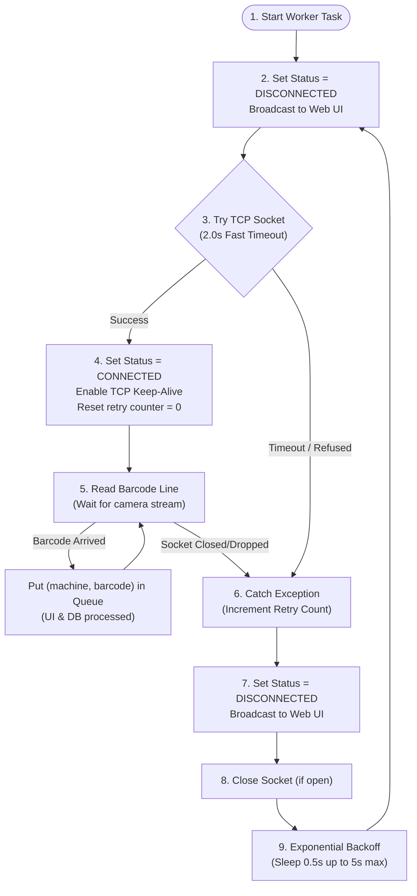

# Technical Architecture & Industrial Networking Documentation
**Project**: Manex Tread Printing RE ("Tread Trace 26 Cam V15" Python Replacement)  
**Author**: Eng. Mazen Ahmed & AI Pair Programmer  
**Last Updated**: August 2026  

---

## Table of Contents
1. [Overview & Tech Stack Decision](#1-overview--tech-stack-decision)
2. [Socket-Level TCP Keep-Alive Probing (`SIO_KEEPALIVE_VALS`)](#2-socket-level-tcp-keep-alive-probing-siokeepalivevals)
3. [Async Camera Worker Lifecycle (`listen_to_device`)](#3-async-camera-worker-lifecycle-listentodevice)
4. [Hot-Reloading Architecture (`.env` & `devices.ini`)](#4-hot-reloading-architecture-env--devicesini)
5. [Consolidated Database Architecture (`db_manager.py`)](#5-consolidated-database-architecture-dbmanagerpy)
6. [Categorized Logging & Automatic 10 MB Rotation](#6-categorized-logging--automatic-10-mb-rotation)
7. [Web Dashboard & WebSocket Streaming](#7-web-dashboard--websocket-streaming)
8. [Windows Service Deployment & Process Isolation](#8-windows-service-deployment--process-isolation)

---

## 1. Overview & Tech Stack Decision
The legacy LabVIEW system (`Tread Trace 26 Cam V15.exe`, archived in [`LabVIEW_Legacy_System/`](LabVIEW_Legacy_System/)) has been replaced by a 100% async Python architecture ([`python_listener.py`](TreadScan_Python_Trace/python_listener.py)). Python was selected for zero-compilation developer velocity, instant test scripting, integrated diagnostic logging, self-contained embedded portability (`python_portable\`), and native WebSocket dashboard streaming.

*Note: The Rust trial ([`RUST Engine Trial/`](RUST%20Engine%20Trial/)) reached 100% feature parity and was archived; it will NOT be continued.*

---

## 2. Socket-Level TCP Keep-Alive Probing (`SIO_KEEPALIVE_VALS`)

### 2.1 The Problem with Standard TCP Sockets
In raw TCP networking without Keep-Alive, if an industrial Zebra camera loses power or a network cable is disconnected, the operating system's TCP socket remains in a "Half-Open" state in memory indefinitely (up to **2 hours** by default in Windows). Python would sit waiting forever on `reader.readline()` without detecting the camera drop.

### 2.2 Low-Level Socket Probing (`SIO_KEEPALIVE_VALS`)
In [`python_listener.py`](TreadScan_Python_Trace/python_listener.py), OS kernel-level socket keep-alive probes are enabled:

```python
sock = writer.get_extra_info('socket')
sock.setsockopt(socket.SOL_SOCKET, socket.SO_KEEPALIVE, 1)
if hasattr(socket, 'SIO_KEEPALIVE_VALS'):
    raw_sock.ioctl(socket.SIO_KEEPALIVE_VALS, (1, 5000, 1000))
```

#### Parameter Breakdown `(1, 5000, 1000)`:
* **`onoff = 1`**: Enables TCP Keep-Alive socket probing (`1` = ON).
* **`keepalivetime = 5000`** (5,000 ms = 5 seconds): Waits 5 seconds of idle inactivity before sending the first heartbeat probe.
* **`keepaliveinterval = 1000`** (1,000 ms = 1 second): If a probe gets no response, re-sends a probe every 1 second until the failure threshold is reached.

#### Result:
Within **5 to 7 seconds** of a network drop or power loss, Windows detects the socket failure, forcibly closes the socket, sets the status to **`DROP DETECTED / DISCONNECTED`**, and triggers automatic reconnection.

### 2.3 Network & Embedded Camera Impact Analysis
* **Network Bandwidth (100 Devices)**: Each camera receives 1 probe (108 bytes exchange) every 5 seconds. Total bandwidth for 100 cameras is **17.28 Kbps (0.0017% of a 1 Gbps LAN)**.
* **Microsecond Interrupt Impact**: Processing a Keep-Alive packet on an embedded Zebra camera takes < **2 microseconds** (0.000002s) inside the kernel. It has **0% impact** on camera CMOS image capture or barcode decoding performance.

---

## 3. Async Camera Worker Lifecycle (`listen_to_device`)



### 3.1 Key Execution Highlights:
1. **Industrial 5.0s Socket Connection Timeout**:
   `asyncio.wait_for(asyncio.open_connection(host, port), timeout=5.0)` allows OS TCP SYN retransmission to complete across industrial plant switches while preventing long thread blocking.
2. **Safe Exponential Backoff**:
   `backoff = min(0.5 * (2 ** min(max(reconnect_attempts - 1, 0), 6)), 5.0)` caps the exponent calculation to prevent `OverflowError: int too large to convert to float` on long disconnects (> 1024 attempts).
3. **Smart Log Suppression & Error Transparency**:
   Camera error logs are recorded on **Attempt #1** (initial drop), upon **Recovery**, and **every 100 attempts** (~10 mins) as a summary heartbeat with full exception name and message formatting.
4. **Self-Healing Watchdog**:
   `watch_devices_config()` checks every 3 seconds whether any camera worker task has crashed or completed, automatically resurrecting it live in memory.

---

## 4. Hot-Reloading Architecture (`.env` & `devices.ini`)

Both key configuration files are **100% hot-reloadable on the fly** while the service runs 24/7:

1. **Environment Config ([`.env`](TreadScan_Python_Trace/.env))**:
   `db_manager.py` re-reads `.env` dynamically on every scan execution. Target toggles (`ENABLE_LOCAL_AUDIT`, `ENABLE_PRODUCTION`) and `ENABLE_LIVE_COMMIT` take effect instantly on the next scan.
2. **Devices Config ([`devices.ini`](TreadScan_Python_Trace/devices.ini))**:
   `watch_devices_config()` checks file mtime (`os.path.getmtime`) every 3 seconds (1 microsecond check, 0% CPU overhead). If `devices.ini` is modified, Python automatically cancels old tasks, spawns new camera tasks, and updates the Web UI dashboard sequence live without restarting the service.

---

## 5. Consolidated Database Architecture (`db_manager.py`)

All database operations are unified into a single clean module [`db_manager.py`](TreadScan_Python_Trace/db_manager.py):

* **Target 1: Local Audit (`LocalAuditTarget`)**: Pure CSV audit logging in `logs/sql_audit.csv` with zero binary SQLite database dependencies.
* **Target 2: Factory Production Server (`ProductionTarget`)**: Executes `csp_AutoProdChange_BY_TRED_CARD` with OUTPUT parameter against `sql-server.plant.local`.
* **15-Second Offline Circuit Breaker**: If a database server drops connection, a 15-second cooldown circuit trips to prevent thread pool exhaustion while allowing other targets to proceed.
* **Safety Commit Toggle**: `ENABLE_LIVE_COMMIT=true` executes `conn.commit()` (Live Insert). `ENABLE_LIVE_COMMIT=false` executes `conn.rollback()` (Dry-Run Rollback Safety).

---

## 6. Categorized Logging & Automatic 10 MB Rotation

All logs are stored in [`TreadScan_Python_Trace/logs/`](TreadScan_Python_Trace/logs/):

| Log File | Description & Contents |
| :--- | :--- |
| **`logs/db_errors.log`** | Untruncated database connection failures & stored procedure tracebacks. |
| **`logs/camera_tcp_errors.log`** | Network dropouts, socket timeouts, and recovery events. |
| **`logs/audit_trace.log`** | Single complete line per barcode scan matching final DB execution status. |
| **`logs/sql_audit.csv`** | Clean CSV audit table (`Timestamp, Machine_Code, Barcode, Stored_Procedure, Status`). |
| **`logs/system.log`** | Service startup, shutdown, and config reload events. |

### 6.1 Automatic 10 MB File Rotation:
In [`tools/logger.py`](TreadScan_Python_Trace/tools/logger.py), every log file is monitored before writing. If a file exceeds **10 MB**, it is automatically rotated to `.old` (e.g. `audit_trace.log.old`), guaranteeing disk usage never exceeds **20 MB per category** during 24/7 factory operation.

---

## 7. Web Dashboard & WebSocket Streaming

1. **Browser DOM Protection & Exact Sequence**:
   The Web UI dashboard at `http://localhost:8088` renders table rows in the **exact sequence specified in [`devices.ini`](TreadScan_Python_Trace/devices.ini)** (`TRGB1`, ..., `C1`). The live scan log feed is capped at **25 cards maximum**, pruning older elements to maintain 0% browser memory overhead.
2. **Quiet Terminal Output (Default)**:
   Barcode read prints are suppressed in console by default to keep the terminal quiet. Pass `--verbose` or `-v` when starting `python_listener.py` to enable live read terminal prints:
   ```powershell
   python "python_listener.py" --verbose
   ```

---

## 8. Windows Service Deployment & Process Isolation

The Python listener is hosted under **NSSM** as the `pycamera` Windows Service running under the bundled `python_portable\python.exe`.

For complete operational and maintenance commands, refer to:
📄 [NSSM_SERVICE_GUIDE.md](NSSM_SERVICE_GUIDE.md)

